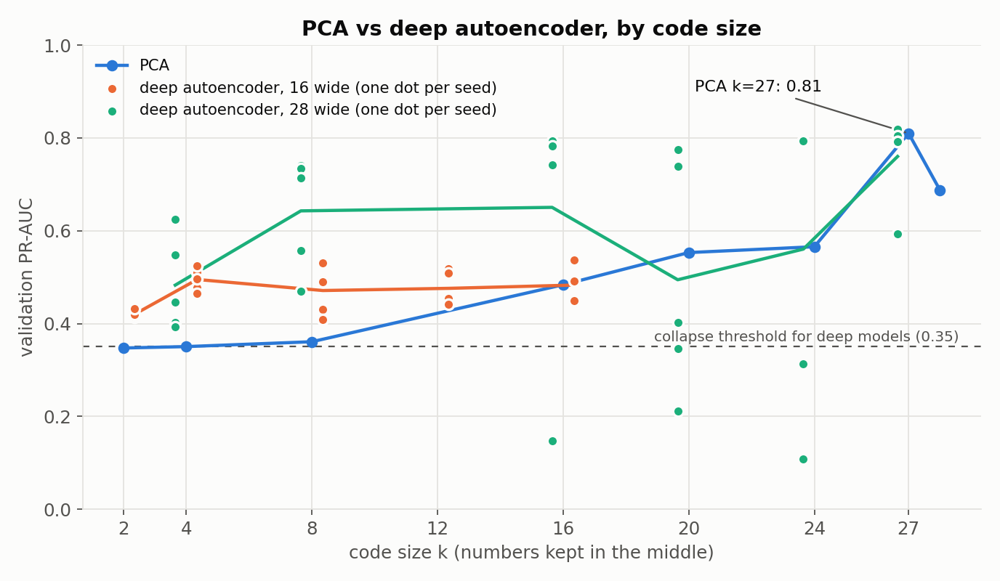
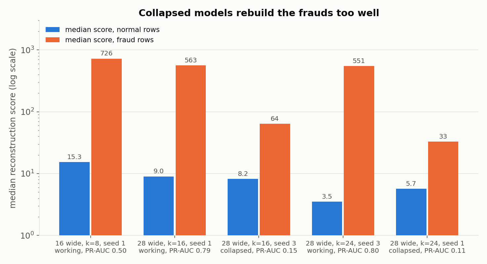
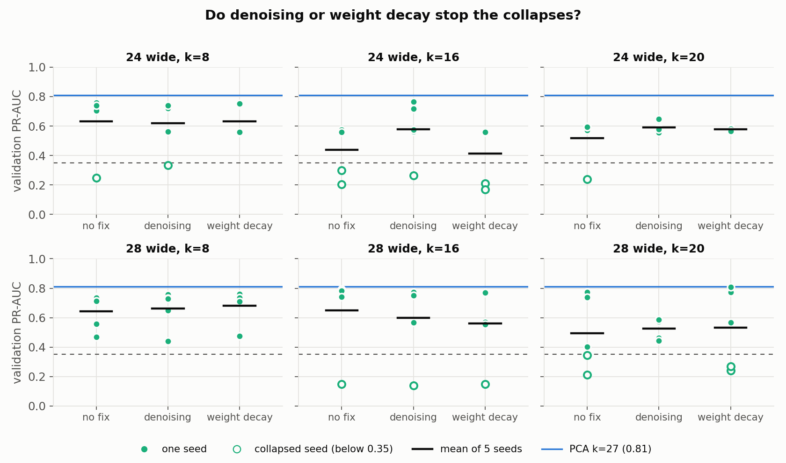

# fraud-spike-detector

Unsupervised fraud detection on 284,807 card transactions. A model learns what normal transactions look like by squeezing each one and rebuilding it; the reconstruction error is the fraud score. PCA is compared with linear and deep autoencoders in PyTorch, using a time-based split.

Work in progress: everything below is measured on the validation set. The test set has not been touched. Detecting bursts of fraud over time windows is the next stage.

## Main result so far

On validation, **PCA with 27 components is the best and most stable detector (PR-AUC 0.81)**. With the same small squeeze, a deep autoencoder beats PCA, but no deep setting beats PCA's best, and wider deep models are unstable: depending only on the random start, some seeds collapse to PR-AUC 0.11 to 0.30.



## Data

Credit Card Fraud Detection (Worldline and ULB): 284,807 transactions over two days, 492 of them fraud. Download `creditcard.csv` from Kaggle (`mlg-ulb/creditcardfraud`) and put it in `data/`. The data is not included in this repository.

## Split

By time, so the model is always tested on transactions that come after the ones it learned from.

| split | time window (seconds) | rows | frauds |
|---|---|---|---|
| train | 0 to 86,400 (day 1) | 144,786 | 281 |
| validation | 86,400 to 129,600 | 47,445 | 96 |
| test | 129,600 to 172,792 | 92,576 | 115 |

Models are fitted on the 144,505 normal train rows only. Amount is replaced by log(1 + Amount), then the 29 features (V1 to V28 and Amount) are scaled with the mean and standard deviation of those rows. The same numbers are used for validation and test.

## Method

- **Score:** squared reconstruction error summed over the 29 features. Higher means more suspicious.
- **Metric:** PR-AUC (average precision) on validation. A scorer that ranks at random would get about 0.002 (96 frauds in 47,445 rows).
- **Neural models:** Adam, learning rate 0.001, 2,000 full-batch steps, seeds 1 to 5. Results are mean ± standard deviation over the 5 seeds.
- **Deep autoencoder shape:** 29 → width → k → width → 29, with ReLU after each hidden layer and a linear output. "Width" is the size of the two hidden layers; k is the code size, the numbers kept in the middle.

## Results (validation)

### PCA

| k | 2 | 4 | 8 | 16 | 20 | 24 | 27 | 28 | 29 |
|---|---|---|---|---|---|---|---|---|---|
| PR-AUC | 0.3474 | 0.3504 | 0.3609 | 0.4836 | 0.5530 | 0.5656 | **0.8100** | 0.6875 | 0.1065 |

At k = 29 nothing is squeezed, every row is rebuilt almost exactly, and the score stops working.

### Linear autoencoder (check)

A linear autoencoder with k = 8 can at best match PCA with k = 8. It scores PR-AUC **0.3633 ± 0.0042** against PCA's 0.3609, which confirms the training code.

### Deep autoencoder

| width | k | PR-AUC (mean ± std) | lowest seed | PCA at the same k |
|---|---|---|---|---|
| 16 | 2 | 0.4199 ± 0.0070 | 0.4139 | 0.3474 |
| 16 | 4 | 0.4950 ± 0.0239 | 0.4654 | 0.3504 |
| 16 | 8 | 0.4712 ± 0.0501 | 0.4089 | 0.3609 |
| 16 | 12 | 0.4759 ± 0.0351 | 0.4410 | |
| 16 | 16 | 0.4830 ± 0.0378 | 0.4441 | 0.4836 |
| 24 | 8 | 0.6331 ± 0.2160 | 0.2484 | 0.3609 |
| 24 | 16 | 0.4398 ± 0.1750 | 0.2036 | 0.4836 |
| 24 | 20 | 0.5180 ± 0.1567 | 0.2384 | 0.5530 |
| 28 | 4 | 0.4829 ± 0.1004 | 0.3930 | 0.3504 |
| 28 | 8 | 0.6429 ± 0.1226 | 0.4699 | 0.3609 |
| 28 | 16 | 0.6504 ± 0.2816 | 0.1479 | 0.4836 |
| 28 | 20 | 0.4944 ± 0.2493 | 0.2115 | 0.5530 |
| 28 | 24 | 0.5605 ± 0.3273 | 0.1086 | 0.5656 |
| 28 | 27 | 0.7601 ± 0.0936 | 0.5938 | 0.8100 |

- With a small code (k = 2, 4, 8), every width beats PCA on average.
- The narrow model (width 16) never collapses but stays between 0.42 and 0.50.
- Wider models (24 and 28) reach 0.74 to 0.82 on some seeds and collapse on others. The best single seed is 0.8183 (width 28, k = 27); its 5-seed mean is 0.7601.

### Why some seeds collapse



A collapsed model has not failed to train; its loss is as low as a working model's. It rebuilds the frauds too well. In the working wide models the median fraud scores 551 to 563; in the collapsed ones, 33 to 64. Most of the lost signal is in V17: its average error on frauds is 227 to 255 in the working wide models and 4.6 to 6.4 in the collapsed ones. The collapsed models have learned to pass these unusual values straight through instead of predicting them from the other features. They also give a few normal rows very high scores (up to 7,318). Dead ReLU units are not the cause: every model checked has 0 or 1.

The narrow model with width 16 and k = 8 has a different weakness: its frauds score high (median 726), but some normal rows score even higher (up to 7,686), which holds its PR-AUC near 0.5.

### Can denoising or weight decay stop the collapses?

Tested on the six unstable settings, everything else unchanged:

- **Denoising:** Gaussian noise of 0.1 added to the training input; the target is the clean row.
- **Weight decay:** 0.001 in Adam.



| width | k | no fix | denoising | weight decay |
|---|---|---|---|---|
| 24 | 8 | 0.6331 ± 0.2160 | 0.6178 ± 0.1750 | 0.6332 ± 0.1043 |
| 24 | 16 | 0.4398 ± 0.1750 | 0.5765 ± 0.1964 | 0.4123 ± 0.2041 |
| 24 | 20 | 0.5180 ± 0.1567 | 0.5890 ± 0.0344 | 0.5767 ± 0.0075 |
| 28 | 8 | 0.6429 ± 0.1226 | 0.6616 ± 0.1303 | 0.6824 ± 0.1183 |
| 28 | 16 | 0.6504 ± 0.2816 | 0.5996 ± 0.2713 | 0.5620 ± 0.2529 |
| 28 | 20 | 0.4944 ± 0.2493 | 0.5266 ± 0.0686 | 0.5321 ± 0.2695 |
| **seeds below 0.35, of 30** | | **7** | **3** | **5** |

Denoising removes more collapses than weight decay, and both make k = 20 with width 24 steady. Width 28 with k = 16 keeps one collapsed seed under every method (0.1479 with no fix, 0.1387 with denoising, 0.1485 with weight decay). Neither raises any mean above PCA's 0.81. Only one strength of each was tried.

## Limitations

- **One validation set with 96 frauds.** Differences of a few hundredths are within seed-to-seed noise.
- **No customer id.** The dataset has none, so transactions from the same customer may sit in train and validation; this cannot be checked. Features are per transaction only.
- **Features are already PCA components** (V1 to V28), which may favour PCA.
- **Fixed training length.** Every run used 2,000 full-batch steps; the planned early stopping on validation loss was not used, and the training loss was often still falling.
- **One noise level (0.1) and one weight decay (0.001).**
- **Not yet done:** Isolation Forest and supervised logistic-regression references, the single test-set evaluation, and window-based burst detection.

## Reproduce

Requirements: Python 3.9, PyTorch, scikit-learn, pandas, NumPy, Matplotlib. Run from `src/`:

```
python pca_sweep.py > ../results/pca.log
python ae_sweep.py 0 8 none > ../results/ae_0_8_none.log
python ae_sweep.py 28 16 none > ../results/ae_28_16_none.log
python ae_sweep.py 28 16 denoise 0.1 > ../results/ae_28_16_denoise_0.1.log
python ae_sweep.py 28 16 wd 0.001 > ../results/ae_28_16_wd_0.001.log
python diagnose.py 28 16 3 >> ../results/diagnose.log
python make_charts.py
```

`ae_sweep.py WIDTH K MODE [AMOUNT]` trains seeds 1 to 5; width 0 means the linear autoencoder. Every run used in this README has its log in `results/`. `data.py` is the original exploration script.
